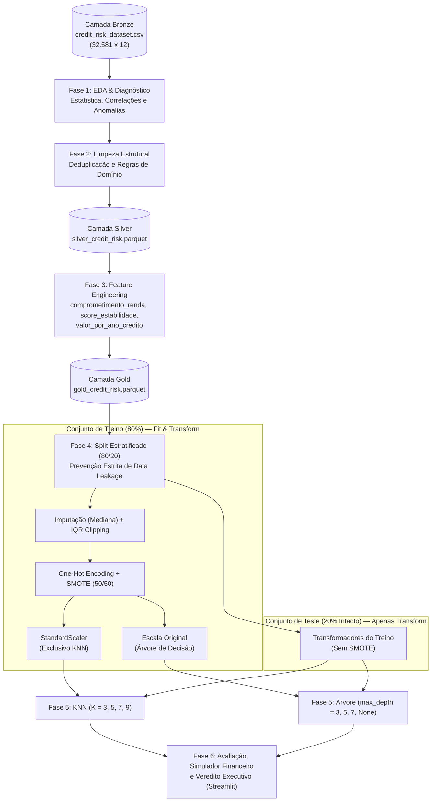

# 🏦 Pipeline Preditivo de Risco de Crédito

[](https://www.python.org/)
[](https://docs.astral.sh/uv/)
[](https://scikit-learn.org/)
[](https://streamlit.io/)
[](https://pandas.pydata.org/)
[](#arquitetura-do-pipeline-medallion--ml)

Solução corporativa ponta a ponta de Ciência de Dados e Machine Learning para previsão de inadimplência bancária (`loan_status`), estruturada na arquitetura **Medallion (Bronze, Silver, Gold)** com prevenção rigorosa contra *Data Leakage*, comparação de hiperparâmetros entre **K-Nearest Neighbors (KNN)** e **Árvore de Decisão (Decision Tree)**, simulação de impacto financeiro e dashboard interativo em **Streamlit**.

---

## 📋 Resumo Executivo

### 1. Principais Insights da Análise Exploratória (EDA)
A análise da base bruta (`32.581` solicitações de crédito e `12` variáveis) revelou características críticas que nortearam toda a engenharia de dados e modelagem:
* **Desbalanceamento Moderado da Classe Alvo:** `78,18%` (`25.473`) dos contratos são adimplentes (`loan_status = 0`) contra `21,82%` (`7.108`) inadimplentes (`loan_status = 1`), exigindo reamostragem sintética (**SMOTE**) restrita ao conjunto de treino.
* **Qualidade e Anomalias Cadastrais:** Identificadas `165` linhas duplicadas exatas, `7` registros com idades inconsistentes acima de `80` anos (`84`, `94`, `123` e `144` anos) e tempos de emprego fisicamente impossíveis (`123` anos de trabalho para solicitantes jovens).
* **Valores Ausentes e Assimetria:** `loan_int_rate` (`9,56%` nulos) e `person_emp_length` (`2,75%` nulos) apresentam forte assimetria e extremos, justificando a imputação pela **Mediana** (robusta a *outliers*) ajustada exclusivamente no treino. Já `person_income` (até `US$ 6.000.000`) recebeu **IQR Clipping** para evitar distorção nas distâncias euclidianas do KNN.
* **Principais Fatores de Risco:** O comprometimento de renda (`loan_percent_income`, $r \approx +0,38$) e a taxa de juros (`loan_int_rate`, $r \approx +0,34$) apresentaram a maior associação linear positiva com o calote.

### 2. Veredito Executivo e Modelo Recomendado para Produção
* **Análise de Risco Financeiro (FN vs. FP):** No setor de crédito, o **Falso Negativo (FN — aprovar um cliente inadimplente)** gera perda direta do capital principal emprestado e provisões (PDD), sendo substancialmente mais oneroso do que o **Falso Positivo (FP — recusar um bom pagador)**, que representa apenas custo de oportunidade de juros.
* **Diagnóstico de Overfitting:** Modelos sem restrição de complexidade — como a Árvore de Decisão com `max_depth=None` (~`100%` de acurácia no treino vs. queda expressiva no teste) — memorizam ruídos e amostras sintéticas do SMOTE. O controle de profundidade (`max_depth=5` ou `7`) elimina o sobreajuste mantendo alta generalização.
* **Modelo Campeão (`Árvore de Decisão com Profundidade Controlada`):** Recomendado para produção por entregar:
  1. **Melhor equilíbrio entre Recall e F1-Score na Classe 1 (Inadimplentes)**, reduzindo perdas diretas por Falsos Negativos;
  2. **Invariância a escala e robustez a *outliers*** residuais (sem depender de `StandardScaler` ou distâncias euclidianas);
  3. **Baixa latência em inferência ($O(1)$)** frente ao custo computacional do KNN sobre bases expandidas pelo SMOTE;
  4. **Alta auditabilidade regulatória**, permitindo extrair regras explícitas de decisão exigidas por áreas de Risco e *Compliance* bancário.

---

## 🏗️ Arquitetura do Pipeline (Medallion + ML)



---

## 📂 Estrutura do Projeto

```text
pipeline-risco-credito/
├── pyproject.toml                  # Configuração de dependências e ambiente (uv)
├── README.md                       # Documentação executiva e guia de execução
├── .gitignore                      # Regras de exclusão de artefatos e cache
├── data/
│   ├── bronze/                     # Dado bruto imutável (credit_risk_dataset.csv)
│   ├── silver/                     # Dados higienizados (.parquet)
│   └── gold/                       # Dados enriquecidos com features (.parquet)
├── artifacts/                      # Modelo campeão serializado (.joblib)
└── src/
    ├── config.py                   # Caminhos, constantes e grades de hiperparâmetros
    ├── fase1_eda.py                # Estatística descritiva e diagnóstico exploratório
    ├── fase2_preprocessing.py      # Limpeza determinística (Bronze -> Silver)
    ├── fase3_feature_engineering.py# Criação de variáveis de negócio (Silver -> Gold)
    ├── fase4_data_split.py         # Split estratificado, SMOTE e StandardScaler seguro
    ├── fase5_modelagem.py          # Benchmark KNN vs Árvore e análise de Overfitting
    ├── fase6_avaliacao.py          # Matrizes de confusão, impacto financeiro e veredito
    ├── run_pipeline.py             # Execução batch via linha de comando (CLI)
    ├── app.py                      # Aplicação interativa Streamlit (Fases 1 a 6)
    └── utils/
        ├── io.py                   # Persistência CSV e Parquet
        ├── metricas.py             # Métricas de classificação e simulador financeiro
        └── graficos.py             # Visualizações padronizadas (Matplotlib/Seaborn)
```

---

## 🚀 Como Executar Localmente com `uv`

### Pré-requisitos
* Python `3.11+`
* [`uv`](https://docs.astral.sh/uv/getting-started/installation/) instalado

### Passo a Passo

1. **Clonar o repositório:**
   ```bash
   git clone https://github.com/HilarioGouveia/pipeline-risco-credito.git
   cd pipeline-risco-credito
   ```

2. **Sincronizar o ambiente virtual e instalar dependências:**
   ```bash
   uv sync
   ```

3. **Adicionar a base de dados bruta:**
   Certifique-se de que o arquivo `credit_risk_dataset.csv` esteja localizado em:
   ```text
   data/bronze/credit_risk_dataset.csv
   ```

4. **Executar a aplicação interativa Streamlit:**
   ```bash
   uv run python -m streamlit run src/app.py
   ```

5. *(Opcional)* **Executar apenas o pipeline analítico via terminal:**
   ```bash
   uv run python -m src.run_pipeline
   ```

---

## 📌 Comandos Rápidos de Versionamento (Git)

```bash
git init
git branch -M main
git remote add origin https://github.com/HilarioGouveia/pipeline-risco-credito.git
git add .
git commit -m "docs: add executive readme, architecture diagram and gitignore"
git push -u origin main
```